# Purchasing Automation Hub

## User Manual

**Application version: V0.2.4**  
**Manual version: 1.0**  
**Document ID: PAH-UM-EN-024**  
**Application release: 12 October 2026**  
**Manual issued: 13 October 2026**  
**VCE China Purchasing Development / System**  
**Internal Use Only**

This manual applies to Purchasing Automation Hub version **0.2.4**, displayed in the application as **SAP Automation Toolbox**. It is for buyers, Purchasing Development users and Key Users. It explains how to prepare an Excel batch, review it, run the released functions and handle interruptions without repeating uncertain SAP changes.

If your application version is different, some screens or functions may vary. Check the version at the bottom of the left navigation before reporting a problem. The application's version is **0.2.4**, not a separate release named 0.24.

> **IMPORTANT** — Start with a small, approved batch. A successful file check does not prove that the data is correct for your business or that you have SAP authorization.

### Revision history

| Manual version | Application version | Date | Main changes |
| --- | --- | --- | --- |
| 1.0 | 0.2.4 | 2026-10-13 | Initial end-user manual for the four released functions, current Source List rules, Safe Recovery and portable distribution. |

### How to use this manual

Read sections 3-7 before your first task. Then follow the guide for your function in sections 8-11. If the Hub pauses, use sections 12-13; for a problem, use section 16. The appendices are for Key Users, not prerequisites for daily operation.

Illustrations show the current interface with fictitious training data. Numbers such as `10000001`, `12345`, `TRAIN-P001` and `TRAIN-RFQ-001` are examples, not approved SAP input or evidence of a real SAP run. Do not upload the examples to Production.

## Contents

1. [About the Hub](#section-1)
2. [Released functions](#section-2)
3. [Before you start](#section-3)
4. [Download and extract the application](#section-4)
5. [First launch and SAP sign-in](#section-5)
6. [Understand the interface](#section-6)
7. [Standard workflow and Clear this page](#section-7)
8. [Create Buyer Receipts and RFQs](#section-8)
9. [Update supplier lead times](#section-9)
10. [Query APQP plan closure dates](#section-10)
11. [Maintain Source Lists](#section-11)
12. [Notifications, confirmations and status](#section-12)
13. [Safe stop, recheck and recovery](#section-13)
14. [Execution History](#section-14)
15. [Results, logs and local data](#section-15)
16. [Troubleshooting](#section-16)
17. [Safe operation rules](#section-17)
18. [Frequently asked questions](#section-18)
19. [Get support and report a problem](#section-19)
20. [Key User appendices and error reference](#section-20)

<a id="section-1"></a>
## 1. About the Hub

Purchasing Automation Hub is a local-first Windows desktop application that reduces repetitive purchasing work and supports batch SAP processing. You provide saved Excel input. The Hub checks the file, shows a preview and processes eligible records using your authorized SAP access.

The four functions create purchasing documents, update purchasing data or query a date. They do not have identical effects. In particular, APQP reads SAP but writes a result to Excel; RFQ, SLT and Source List can change SAP business data.

The Hub keeps execution history and diagnostic information on your computer. SAP communication still uses the company systems and network. The Hub does not replace your business approval process, maintain missing master data automatically or guarantee a completion time.

<a id="section-2"></a>
## 2. Released functions

Use **Operations** to find these four task cards. The order can change according to this computer's recent usage.

| Function | What it does | SAP access | SAP write and confirmation | Result |
| --- | --- | --- | --- | --- |
| Batch Buyer Receipt / RFQ from NPL | Finds NPL materials and creates Buyer Receipts and RFQs grouped by Plant, Project and Supplier Parma. | SAP GUI; ZMFM050072. | Yes. Review the Production confirmation and select Confirm and Start. | Separate working workbook with status and RFQ numbers. |
| Batch Supplier Lead Time (SLT) | Updates purchasing Info Record lead times for Standard or Consignment purchasing. | SAP WebGUI in Chrome/Edge; ME12. | Yes. Review Ready to update, then Start Automation. | Workbook results with old lead time, status and time. |
| Batch APQP Plan Close Date query | Queries the plan closure date for a Material/Vendor combination. | SAP GUI; ZMFM050035. | No SAP write. Start query does not ask for a purchasing-write confirmation. | Date in Excel column E; row outcomes in the local run log. |
| Batch Source List maintenance | Adds or reuses the intended supplier row, sets Fix and MRP 1 and applies the selected dual-sourcing rule. | SAP GUI; ME01. | Yes. Review Ready to update, then Start Automation. | ME01 Status, Error Message and Updated At in Excel. |

PR/ME52N modification is **not** available in the normal V0.2.4 interface. Increasing a worker setting does not enable parallel RFQ or Source List processing.

<a id="section-3"></a>
## 3. Before you start

Complete this checklist:

- Use an approved company Windows computer and the approved V0.2.4 package.
- Connect to the company network or required VPN.
- Have Microsoft Excel installed and a writable location for your input and saved results.
- For RFQ, APQP and Source List, have SAP GUI installed with SAP GUI Scripting permitted by company policy.
- For SLT, have the selected Google Chrome or Microsoft Edge installed.
- Have the required SAP business authorization. SLT requires **ME12 purchasing Info Record change authorization**; ask your Key User or IT if it is unavailable.
- Know the intended SAP environment and Plant. Sign in yourself through SAP or the browser when requested.
- Save your Excel input and review Material, supplier, quantity and date values before upload.
- Reserve the SAP windows used by the Hub. Do not leave unsaved manual work in them.

Packaged users do **not** need to install Python, pip packages, Node.js or developer tools. Company SAP GUI, Excel, browser, access permissions and network requirements still apply.

> **WARNING — Production access** — The normal RFQ page targets **VCE Production [949], Client 100**. `[949]` identifies the SAP Logon entry; it is not the SAP client. There is no QA selector on this page. Ask a Key User to arrange an authorized trial; do not assume that the normal page runs in a test system.

<a id="section-4"></a>
## 4. Download and extract the application

### 4.1 Choose a writable local folder

Download the ZIP package, then extract the **entire package** to a writable local directory on the C: drive. A suitable example is:

`C:\Users\<YourUserName>\PurchasingAutomationHub\`

`C:\PurchasingAutomationHub\` is also suitable **if you have write permission** there. You do not need administrator rights merely to extract into your own permitted local folder.

Avoid network/shared drives, restricted company folders, read-only directories and SharePoint/OneDrive-synced execution folders. A drive letter alone does not prove that a location is local or writable.

### 4.2 Extract and start

1. Obtain the ZIP from your approved internal distributor or Key User.
2. Right-click the ZIP and select **Extract All**.
3. Choose the writable local folder.
4. Wait until extraction finishes. Do not launch while files are still being copied.
5. Open the extracted folder.
6. Confirm that `SAP Automation Toolbox.exe`, `resources`, `locales` and the accompanying files remain together.
7. Double-click **SAP Automation Toolbox.exe**.

> **IMPORTANT** — Do not run the EXE from inside the ZIP. Do not copy only the EXE or move individual DLL/runtime files out of the package. The complete folder is the application.

For an update, stop all tasks and close the old Hub first. Extract the new version to its own complete folder; do not mix files from different versions. Local history and settings are per-user data, not ordinary files inside the installation folder. Do not delete that data to try to fix a startup issue.

### 4.3 If Windows warns about the publisher

This portable build is unsigned, so Windows may display an **Unknown Publisher** or security warning. Verify the source with your Key User and follow company policy before proceeding. If endpoint protection blocks the program, contact IT. Do not disable antivirus, bypass company controls or repeatedly force-launch the file.

If selecting Run produces no window, use the startup cases in section 16. A successful startup on another computer does not guarantee approval by your endpoint's security policy.

<a id="section-5"></a>
## 5. First launch and SAP sign-in

1. Wait for the **Dashboard**. Its first-run totals can be zero; this is normal.
2. Check **Version 0.2.4** at the bottom of the left navigation.
3. Open **Settings** if you want to change language, theme, text size or sounds. Select **Save Settings**.
4. Open **Operations** and choose a function. You do not need to configure a Python path or an `.env` file.

For native SAP functions, the Hub uses an eligible signed-in SAP GUI session. When SAP is not open, it may open installed SAP Logon; you still select the intended environment and complete sign-in. If it cannot identify a safe session, follow the sign-in prompt rather than clicking randomly in SAP.

For SLT, browser windows open for WebGUI access. Windows may ask you to choose a client certificate. Select your authorized certificate and complete SAP sign-in in **every opened worker window**. The Hub does not automatically dismiss the certificate dialog. After completing the requested login, use the available Continue/Recheck button in the Hub.

The Hub does not ask for or store your SAP password. Never enter it into a template, log or support message. Browser profiles may retain login state according to browser and company policy.

> **NOTE** — If SAP displays a multiple-logon warning, do not select an option that ends other logins just to make automation proceed. Stop and ask your Key User to identify the correct available session; unsaved work in other logins can be lost.

<a id="section-6"></a>
## 6. Understand the interface

### 6.1 Dashboard

The Dashboard shows the four available functions, runs today, successful and failed runs, recent activity and estimated time saved. These are local history-based statistics, not company-wide totals. New computers and cleared history have little or no data.

Estimated time saved uses confirmed successful groups/records and deducts the full batch runtime, including SAP and user waits. It is an **estimate**, not a measured personal productivity result. Reference manual effort is RFQ 35 minutes/group and SLT, APQP and Source List 5 minutes/record. Source List remains a reference assumption; Key Users can adjust and calibrate the baselines.

Skipped, failed, cancelled and unresolved work is not counted as successful work. Deleting history can reduce these statistics.

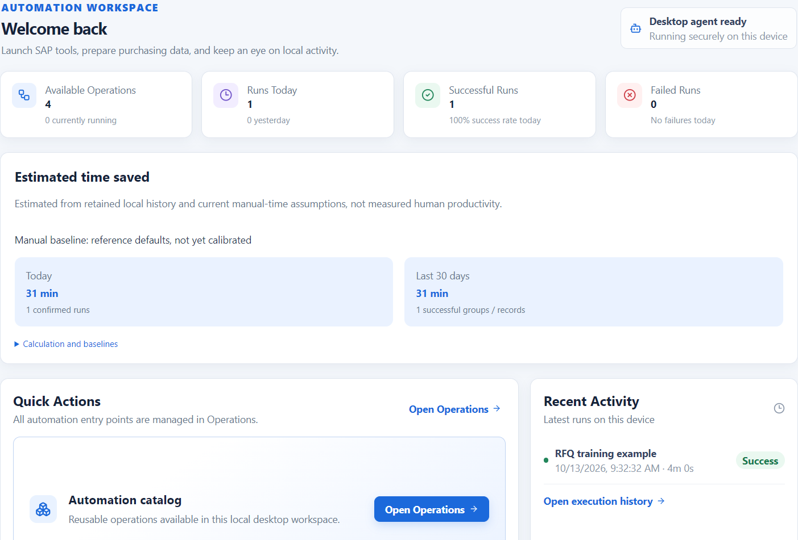

*Figure 1 - Dashboard and local estimated savings. Training illustration.*

### 6.2 Operations

Select **Info** for a short description and operating steps. Select **Open** to enter the task page. The Info button provides written guidance in this release, not a built-in video library.

Frequently/recently used functions may appear higher based on this device's last 60 days of history. New users see the default order. Cards do not keep moving while the page is open.

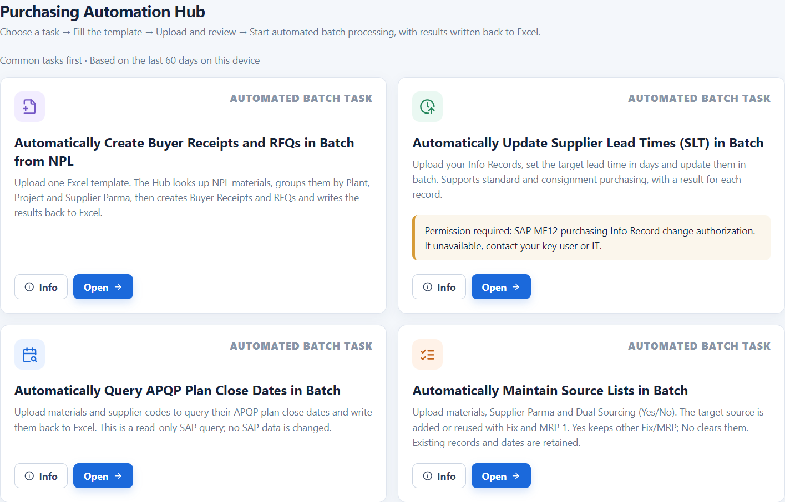

*Figure 2 - Operations with the four released tasks and the SLT permission reminder.*

### 6.3 Task pages

The top task controls contain **Start Automation** or **Start query**, **Stop safely** while running, and **Clear this page**. Below them, prepare Excel, review the batch, then view progress and results. File selection, business options and displayed results remain available when you navigate between pages during the current Hub session. Do not rely on restart as an automatic task continuation.

### 6.4 Settings

Normal settings are **Language**, **Theme**, **Text Size**, **Notification Sounds** and **Open Result After Completion**. Save changes with **Save Settings**. Automatic result opening applies to the three guided tasks (SLT, APQP and Source List); use **Open Result File** for RFQ.

> **IMPORTANT** — Do not change **Advanced / Key User Settings** unless instructed. Browser, worker limits, WebGUI URL, download location and manual-time baselines affect company-specific operation.

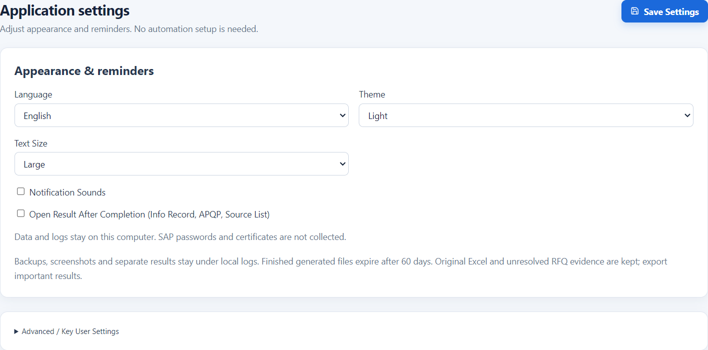

*Figure 3 - Normal Settings; Advanced settings are collapsed.*

<a id="section-7"></a>
## 7. Standard workflow and Clear this page

**Choose function → Download template → Fill and save Excel → Upload → Automatic validation → Review preview → Confirm if required → Run → Review and save results.**

1. In Operations, select the required task's **Open** button.
2. Select **Download template**. Choose the save location in the dialog. The notification reports the actual saved path; it is not necessarily Downloads.
3. Enter input on the task's input worksheet, beginning at row 2. Keep required headers and the package's template structure.
4. Save Excel before selecting **Upload completed template**.
5. Wait for validation. If it fails, read the details, correct and save the file, then upload again. Start remains unavailable until eligible data is ready.
6. Check counts, samples, suppliers, dates and business options. Do not treat a valid file as business approval.
7. For SAP-writing tasks, review the confirmation and authorize the batch once. APQP starts its read-only SAP query without that purchasing-write confirmation.
8. Keep SAP/browser windows open and let the Hub work. Monitor status rather than clicking inside its active sessions.
9. Review completed, skipped and failed outcomes. Open the result and save important output to approved business storage.

> **WARNING** — Do not edit purchasing inputs, sort rows or rename worksheets while a batch is running. Excel may stay open, but the data being processed must remain stable.

### 7.1 Clear this page is not deletion or rollback

Use **Clear this page → Confirm Clear** to reset this task's selected file, business options, preview, messages and displayed results. Other task pages are unaffected. The action is unavailable during processing.

It does **not** delete uploaded Excel files, downloaded templates, execution history or logs, and it does not undo SAP changes. Choose Cancel if you want to keep the current page. **Run Another Task** on a guided result also resets that page. Log cleanup is a different action, explained in section 14.

<a id="section-8"></a>
## 8. Create Buyer Receipts and RFQs

### 8.1 Purpose and Production warning

Open **Automatically Create Buyer Receipts and RFQs in Batch from NPL**. The Hub finds the specified NPL materials, creates a Buyer Receipt, confirms its saved green status and continues to RFQ creation.

> **WARNING — Production Operation** — This task creates real purchasing documents in VCE Production [949], Client 100. Confirm the Plant, Project, supplier, quantities and dates before authorizing it. The ordinary page has no QA switch and does not offer parallel RFQ workers.

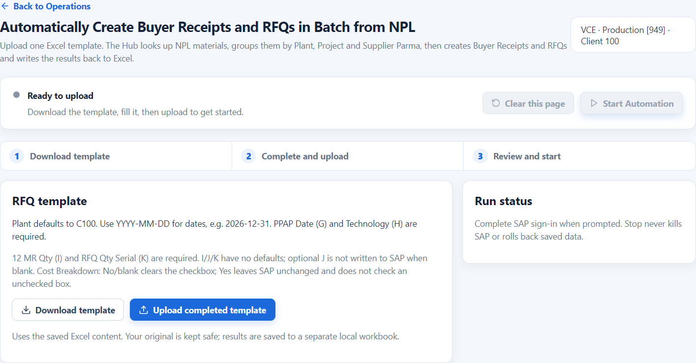

*Figure 4 - RFQ preparation, Download template and Upload completed template.*

### 8.2 Complete the RFQ template

Use `Create_RFQ_Template.xlsx`, worksheet **RPA_Input**. One input row represents one Material for the specified Plant, Project and supplier. Keep every header even when an optional value is blank. Fill approved quantities; do not include units or explanatory text in quantity cells.

| Column | Header | What to enter |
| --- | --- | --- |
| A | Plant | Required. Default template Plant is C100; check every populated row. |
| B | Project No. | Required approved project identifier. Use the current header, not an old MPP label. |
| C | Material No. | Required Material identifier. |
| D | Supplier Parma | Required intended supplier code. |
| E | Supplier Email | Keep the header. Enter an approved email when required by the RFQ/email workflow; a supplied address must be valid. Blank is not rejected by file validation alone. |
| F | Quotation Due Date | Required. Use YYYY-MM-DD, for example 2030-12-31, or a genuine Excel date. |
| G | PPAP Date | Required in the Hub template. Supply an approved date. |
| H | Technology | Required Technology user/code for the Buyer Receipt. |
| I | 12 MR Qty | Required approved 12-month quantity; no default is inserted. |
| J | RFQ Qty Prototype | Optional. Blank means the Hub does not write that prototype quantity to SAP; it does not mean zero. |
| K | RFQ Qty Serial | Required approved serial quantity; no default is inserted. |
| L | Cost Breakdown | Yes preserves SAP's existing checkbox state. No or blank explicitly clears it for the configured supplier. |

> **IMPORTANT — Cost Breakdown** — Yes does **not** automatically check an unchecked box. No/blank forces an existing check off. Review this business choice before every batch.

For dates, use an unambiguous year-month-day format. The Hub can normalize several formats, but do not rely on ambiguous day/month order. Quantity cells I/J/K are intentionally blank in a fresh template; populate I and K yourself.

### 8.3 Upload and review

1. Save the filled workbook and upload it.
2. Review **Materials**, **RFQ groups**, **Invalid rows**, duplicate notes and warnings.
3. If a required field is blank, correct it and re-upload. The preview identifies the Excel row.
4. Expand **View details · RPA_Input** to inspect the input rows and validation messages.
5. Review each Parma group, including every listed Material.

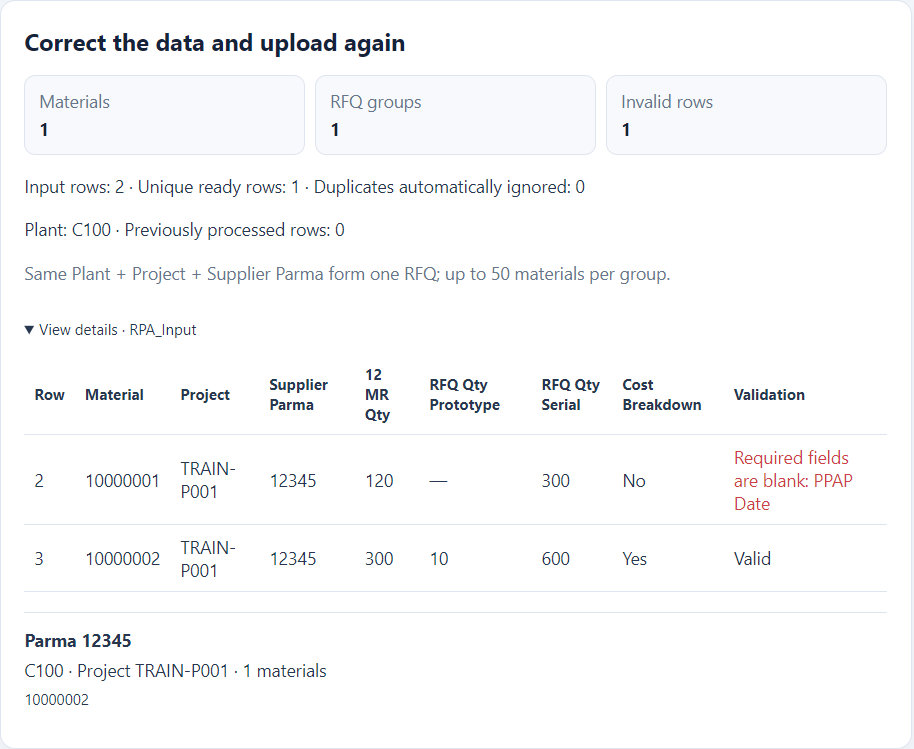

*Figure 5 - Required-field validation using an intentionally incomplete training row.*

The grouping key is **Plant + Project + Supplier Parma**, with a maximum of **50 materials per RFQ group**. A larger eligible group is split. An identical input duplicate is skipped; different business inputs for the same Material/group must be corrected. An existing successful workbook status can also exclude a row from new execution.

The engine uses the first row's shared header inputs in a group. If emails, quotation dates or other shared header values differ, the preview warns you. Resolve unintended differences before starting; grouping is not an instruction to create separate RFQs for each differing date.

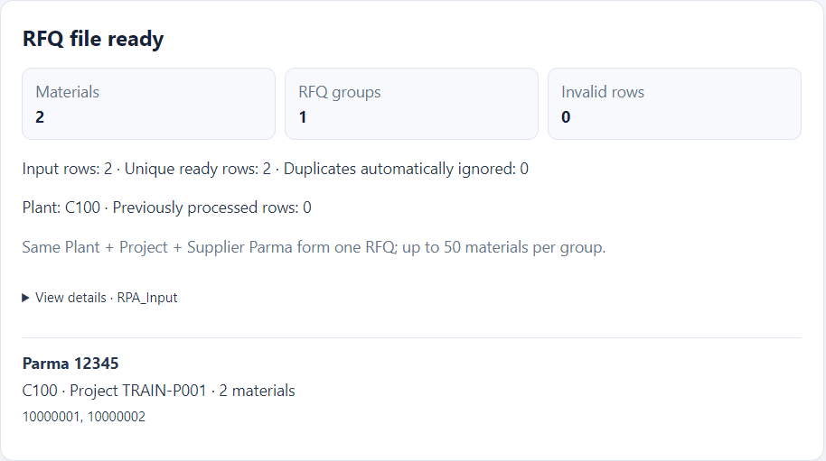

*Figure 6 - RFQ preview and one training supplier group.*

### 8.4 Confirm and run

1. Select **Start Automation** in the top task controls.
2. Read **Ready to Start**. Verify VCE Production [949] / Client 100, group count and Material count.
3. Select **Cancel** if anything is wrong. Otherwise, select **Confirm and Start**.
4. Complete SAP sign-in if requested. Do not create another identical batch while this one is running or paused.
5. Monitor progress through NPL lookup, Commodity pre-check, Buyer Receipt, saved green-status check, RFQ and result saving.

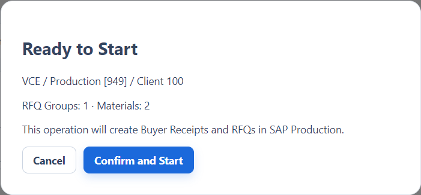

*Figure 7 - Production confirmation before RFQ execution.*

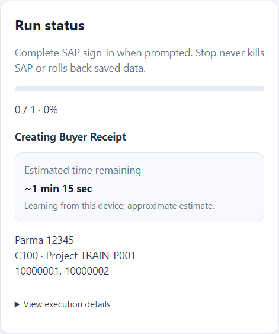

*Figure 8 - RFQ run status using simulated training progress.*

Progress counts completed **groups**, not individual material rows. A group can include multiple materials, and a processed group may be skipped rather than newly created. The remaining-time estimate can change as SAP responds; it is not a promised finish time.

### 8.5 Commodity and Buyer Receipt checks

Before creating a Buyer Receipt, the Hub verifies Commodity on freshly matched NPL data. If **Commodity Information Required** appears:

1. Read the affected Material numbers.
2. Use **Open Fix Session** if available, or a separate existing SAP session.
3. Maintain the correct Commodity with appropriate authorization. Keep the paused NPL automation page unchanged.
4. Return to the Hub and select **I've Fixed It – Recheck**.
5. Wait for verification. If the issue remains, the task stays paused.

An extra correction session may be unavailable because of SAP limits or permissions. This does not authorize changing the automation session's page. Ask your Key User for a safe correction route.

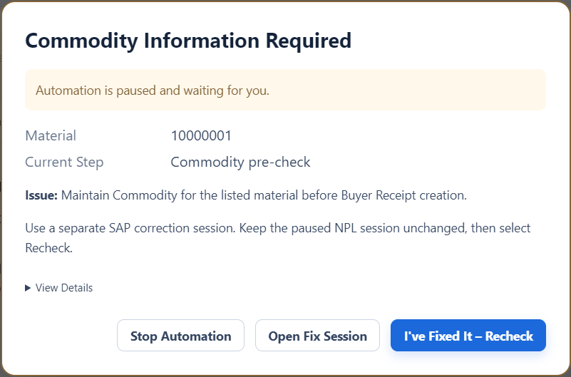

*Figure 9 - Commodity pause with a separate correction-session option. Training illustration.*

**NPL Data Could Not Be Read** is different: a technical reading failure does not prove Commodity is missing. Use **Recheck NPL Data** when offered, or ask your Key User to check the correct screen/data. Do not change master data merely to silence a reading error.

If SAP already has a valid PPAP date, it is retained. If it is missing or too early, the Hub may use the valid supplied Excel date. A row that still needs a valid PPAP date is recorded for review rather than being assumed complete. A Buyer Receipt must pass the saved-green check before RFQ continues. Only a specifically offered, verified recovery permits manually correcting and saving the current Buyer Receipt, then selecting Continue; do not manually Save/Create during ordinary running.

### 8.6 Review RFQ numbers and results

1. Review **Successful RFQs**, **Skipped** and **Failed**; do not assume processed count equals newly created documents.
2. Read **Created RFQ numbers** on the page.
3. Select **Open Result File**. The original uploaded workbook remains protected; the working result receives the statuses.
4. In the working workbook, inspect **Buyer Receipt Status**, **RFQ Status**, **RFQ Number**, **Error Stage** and **Error Message**. Successful Material rows in the same created group receive the same RFQ number.
5. Save a business copy of the result outside the Hub's temporary/run storage.

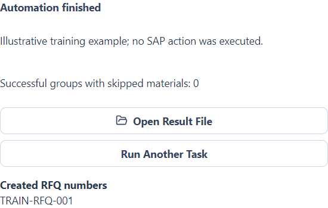

*Figure 10 - RFQ result controls and a fictitious training RFQ number.*

If SAP may have created an RFQ but no number was confirmed, treat the outcome as uncertain. An empty number does **not** prove nothing was created. Stop and verify SAP before rerunning.

<a id="section-9"></a>
## 9. Update supplier lead times

Open **Automatically Update Supplier Lead Times (SLT) in Batch**. This uses WebGUI ME12 and supports **Standard** and **Consignment** Info Records.

> **WARNING — Purchasing update** — This function changes SAP lead times. Ensure ME12 change authorization and confirm that the selected Info category and target days are correct.

### 9.1 Input and business options

Use `ME12_Supplier_Lead_Time_Template.xlsx`, input sheet **ME12 Upload**. Fill **Purchasing Info Rec.** in column A and **Plant** in column B. Preserve identifiers as text when necessary to avoid losing leading zeros. The Hub normalizes the numeric Info Record to 10 digits.

On the page, review **Plant**, **Purchasing Organization**, **Supplier Lead Time (days)** and **Purchasing Type**. Defaults are C100, C100, 1 day and Standard. The UI accepts whole days from 0 to 999; use the value approved for your business. Subcontracting and Pipeline are not selectable in this release.

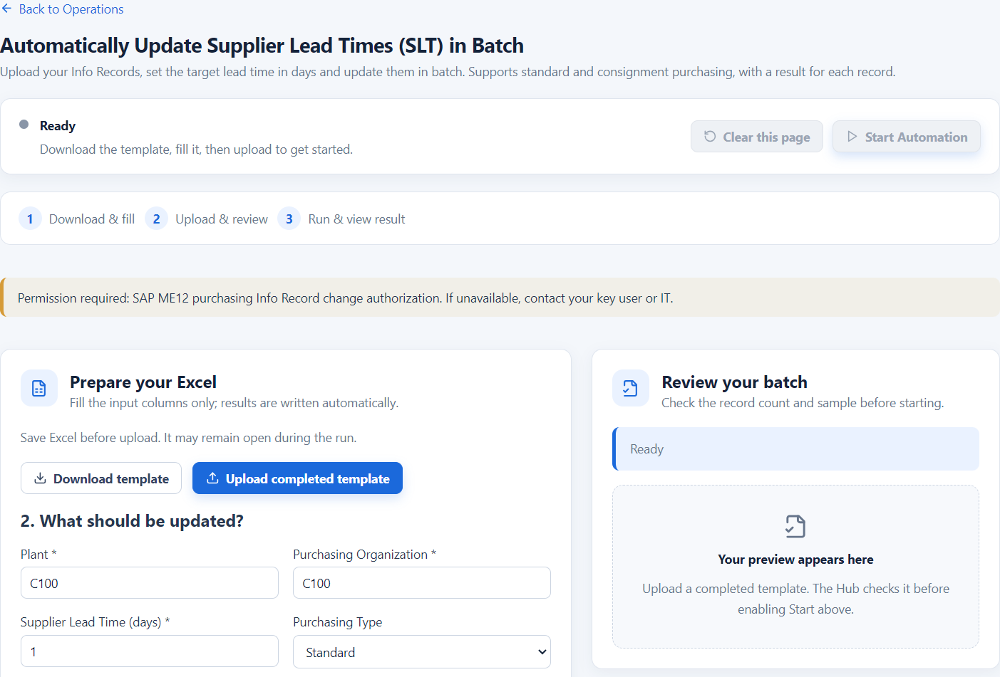

*Figure 11 - SLT preparation, permission reminder and Standard/Consignment choice.*

### 9.2 Run the batch

1. Download, fill and save the template; upload it.
2. Check selected Info Record count and sample. Only the selected Plant is processed; duplicates are combined for processing and results are applied to the corresponding input rows.
3. Choose Standard or Consignment and review the organization and target days. Changes to business options trigger validation again.
4. Select **Start Automation**, read **Ready to update**, then confirm with **Start Automation**.
5. Complete certificate selection and SAP login in every opened browser. All worker windows must be ready before record updates begin.
6. Leave the browser windows alone while working. An already-correct lead time can be skipped as no change needed.
7. Review the result, including **ME12 Status**, **Old Supplier Lead Time** and **ME12 Updated At**.

The Key User's worker setting is a maximum, not a promise of that many windows for a small batch. The Hub limits the workers to the available work and permitted browser slots. Increasing this setting does not make RFQ or Source List concurrent.

Excel may remain open. If its file is locked, SLT saves a separate timestamped result under the run logs rather than forcing an overwrite of the open workbook. Always use the returned **Open Result** location; do not assume the open original now contains every result.

When a record cannot be verified, new work stops; workers already in flight may finish and results are saved before a Stop-only pause. Review the affected record in SAP before retrying it.

<a id="section-10"></a>
## 10. Query APQP plan closure dates

Open **Automatically Query APQP Plan Close Dates in Batch**. It reads the APQP plan closure date from SAP and writes it to Excel. It does **not** maintain or save SAP master/transaction data.

### 10.1 Input and choices

Use `APQP_Plan_Closure_Template.xlsx`, input sheet **APQP_Input**.

| Column | Header | Use |
| --- | --- | --- |
| A | Part No. | Required Material for the query. |
| B | Ver | Optional reference information; not used as a query selection. |
| C | Description | Optional reference information; not used as a query selection. |
| D | Vendor | Required supplier code. |
| E | APQP plan closure date | Result date. Leave blank for a new query, or retain an existing date. |

Keep the supplied worksheet structure. Any additional columns in the downloaded template do not change the current output column: the Hub writes the plan closure date to **E**, not to an additional similarly titled column.

On the page, select Plant (default C100) and **Refresh dates already in Excel**. **No — keep existing dates** is the default; **Yes — query again** includes rows that already have a date.

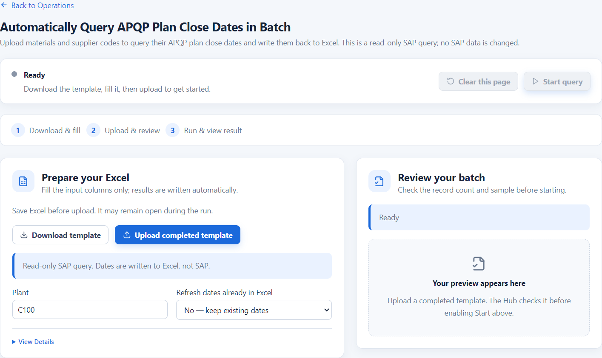

*Figure 12 - Read-only APQP query and existing-date choice.*

### 10.2 Query and review

1. Fill Material and Vendor, save and upload.
2. Review selected, skipped and incomplete rows. Correct incomplete Material/Vendor pairs before querying.
3. Select **Start query**. No purchasing-write confirmation is required because SAP is read only.
4. If requested, sign into the intended environment and return available idle SAP sessions to SAP home.
5. Monitor the **actual SAP session** count. Up to the Key User's configured maximum can be used; default maximum is three. If only one eligible session exists, only one worker runs. The Hub does not automatically create extra sessions for this query.
6. Open the result Excel file and review column E and the run totals. Row outcomes and messages are available in the run's diagnostic CSV for Key User review.

When several SAP results exist, the query reads the **first result row**. It does not combine every APQP plan or choose the latest date. Ask your Key User to confirm whether that selection is appropriate for the business case.

**NO_RESULT** means no usable result was returned; it can also represent a SAP query message. Read the associated message before assuming no plan exists. **NO_DATE** means the selected detail had an empty plan closure date. These outcomes do not write an invented date. A detail popup, reading error or uncertain query state can instead stop scheduling and require review.

Excel can remain open and the Hub writes through Excel. Do not change Material/Vendor or dates while querying: the Hub checks for conflicts and can refuse the writeback. If a copy is read-only or open in another Excel instance, close that conflicting copy only after saving your work and follow the error instructions.

<a id="section-11"></a>
## 11. Maintain Source Lists

Open **Automatically Maintain Source Lists in Batch**. Plant is fixed to **C100**. The task can add or reuse the target supplier row, set its **Fix** indicator and **MRP = 1**, then save after checking the planned state.

> **WARNING — Source selection** — Changing Fix/MRP can affect source determination and planning. Confirm the intended supplier and dual-sourcing decision with your business owner before running.

### 11.1 Template and new-row options

Use `ME01_Source_List_Template.xlsx`, worksheet **ME01_Input**.

| Column | Header | Input or result |
| --- | --- | --- |
| A | Material No. | Required Material. |
| B | Parma | Required intended supplier code. |
| C | Dual Sourcing | Required explicit Yes or No. Blank is an error, not No. |
| D | ME01 Status | Written by the Hub; do not fill as input. |
| E | Error Message | Written by the Hub. |
| F | Updated At | Written by the Hub. |

New-row page options are **Purchasing Organization** (default C100), **Valid from** (default local current date when the page is initialized/reset) and **Valid to** (default 2099-12-31). Review the start date if you left the Hub open overnight. **Clear this page** resets it to the current default. The new-row date is written directly in SAP's day-month-year format; the automation does not open a calendar picker.

### 11.2 Understand Yes versus No

| Template choice | Target supplier | All other supplier rows |
| --- | --- | --- |
| Yes | Add/reuse the intended row; set Fix and MRP 1. | Preserve their existing Fix, MRP, suppliers and dates unchanged. |
| No | Add/reuse the intended row; set Fix and MRP 1. | Clear Fix and MRP on **all** other rows, including expired/future rows. Keep suppliers, dates and other row data. |

No does not delete the previous supplier; it switches the fixed/MRP indicators. Yes does not mean that the Hub creates a second new unrelated supplier: you supply the one target Parma, and other existing rows are retained. SAP still applies its own validation rules.

An existing unique target row that covers the requested validity is reused to avoid duplicates. If multiple targets cover the period, or an existing target has an overlapping but different/shorter validity, the Hub stops for review rather than guessing, overwriting dates or adding a duplicate.

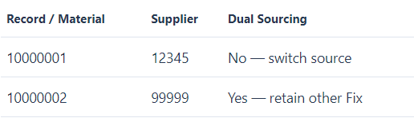

*Figure 13 - Source List sample with Supplier Parma and explicit Yes/No training choices.*

### 11.3 Run and verify

1. Fill Material, Parma and Yes/No for each populated row; save and upload.
2. Review samples and the counts for No (switch fixed source) and Yes (retain other Fix).
3. Review validity dates and organization. Duplicate rows must have the same supplier and Yes/No choice; conflicting data blocks the batch.
4. Select **Start Automation**, read the effect on other rows in **Ready to update**, then confirm.
5. Sign in and provide an eligible idle SAP session if requested. Do not manually scroll/edit its Source List while the Hub is reviewing it.
6. Review **ME01 Status**, **Error Message** and **Updated At** in the result workbook. Excel can remain open and is updated through Excel when the same workbook is detected.
7. Verify a small approved sample in SAP: target Fix/MRP, other-row behavior and retained supplier rows/dates.

If the requested state already matches, the Hub checks SAP and skips Save. A prior SUCCESS in Excel alone is not sufficient; SAP is checked again. Read-only controls, unreadable rows or a mismatched readback stop safely. There is no automatic repeat Save after an uncertain outcome.

<a id="section-12"></a>
## 12. Notifications, confirmations and status

### 12.1 Notifications and sounds

Success indicates completion; attention means you need to review a warning or act; error means the task cannot safely complete. A batch with skips/issues can finish with an attention notification. Disable sounds in Settings if necessary. A sound failure does not change the task's status or authorize a SAP action.

Read the notification text and result counters. Never rely on color or sound alone.

### 12.2 Action Required buttons

See Figure 9 for the Commodity pause example. Read the specific issue and permitted actions before responding.

| Button | Meaning and permitted action |
| --- | --- |
| Continue | Available only at a supported recovery point. Correct the described issue first; the Hub verifies the current SAP state before proceeding. |
| I've Fixed It - Recheck | Commodity was reported missing. Verify your correction in a separate session, then let the Hub query/check NPL again. |
| Recheck NPL Data | The data could not be read. Recheck the expected screen/data; do not assume missing Commodity. |
| Check Again | Retry the available state check after a failed verification or eligible slow-state pause. It is not an instruction to replay Create/Save. |
| Open Fix Session | When offered for missing Commodity, opens a separate correction session if permitted. It does not maintain Commodity itself or resume the original task. |
| Stop Automation | Requests safe stopping and preserves completed changes/results. It is not rollback. |
| View Details | Displays additional message, Run ID, group, Excel rows and recovery point. Read/copy it for support. |

Not every pause has Continue. An unknown/uncertain write outcome may offer **Stop Automation only**. Escape does not dismiss the pause. If a prompt requests fields, fill only the requested business information; never provide a SAP password.

### 12.3 Status reference

Guided task labels and execution-history labels are different views of the run:

| Task label | What it means | What to do |
| --- | --- | --- |
| Ready | Prepare input. | Download/fill/upload. |
| Validating file… | File/options are being checked. | Wait. |
| Ready to start | Eligible data is available. | Review, then Start. |
| Running | Automation is active. | Leave active SAP sessions alone. |
| Paused - waiting for you | A verified user action is needed. | Read the dialog and permitted buttons. |
| Checking SAP… | The Hub is verifying your correction/state. | Wait; the task remains paused. |
| Completed | The guided task finished. | Open and retain the result. |
| Completed with warnings | Skips or issues need review. | Inspect row outcomes. |
| Could not complete | Safe completion failed. | Review details/SAP before retry. |
| Stopped | The task stopped/cancelled. | Review partial results. |

RFQ uses its own progress messages such as Finding NPL materials, Creating Buyer Receipt, Creating RFQ and Run finished. History statuses include **Running, Interrupted, Success, Partial, Failed and Cancelled**. Interrupted requires review; Success at run level is not evidence that every row created a new object. The header Application status stays Running while work is active, with waiting/checking states taking precedence.

<a id="section-13"></a>
## 13. Safe stop, recheck and recovery

### 13.1 Stop safely

1. Use **Stop safely** in the task controls, or **Stop Automation** in the pause dialog.
2. Wait for **Stopping safely…** and the terminal result. Do not press Stop repeatedly or close SAP to make it quicker.
3. Open the partial result and review what was saved before preparing a retry.

> **IMPORTANT — Stop is not rollback** — Already-saved SAP changes remain. A task that stops can still have created a Buyer Receipt/RFQ or updated records.

Before a new RFQ Create/Save action has been sent, a read-only wait can stop promptly. After an action has been sent, the Hub may protect current-group completion, RFQ-number capture and Excel saving before stopping. An in-flight native SAP call must return; it cannot be forcibly interrupted by the Stop button. No next RFQ group is intentionally started after the stop request is honored.

SLT workers may finish their in-flight records; Source List finishes the current material's verification/Save once edits begin; APQP drains current read-only queries and saves results. Closing the Hub during a task requests the same safe stop and can take time. Keep the Hub/SAP open until the final state appears whenever possible.

### 13.2 Recheck within the running Hub

The supported flow is **Pause → Correct the specific issue → Recheck → Safe state confirmed → Continue**. Continue is not Ignore. If the correct state cannot be proved, the task remains paused or only allows Stop. A stopped batch and a paused recoverable batch are not interchangeable.

Do not start another copy of the same batch while the first is paused. Never retry simply because a message disappeared or a result number is blank. Compare saved results with SAP first.

### 13.3 Safe Recovery after restart

If a previous RFQ run was unfinished/uncertain, the Hub displays **An unfinished RFQ run was found**, including Project, completed groups and last confirmed checkpoint. For example, 7/12 groups and Buyer Receipt saved do not prove that the current group's RFQ was never created.

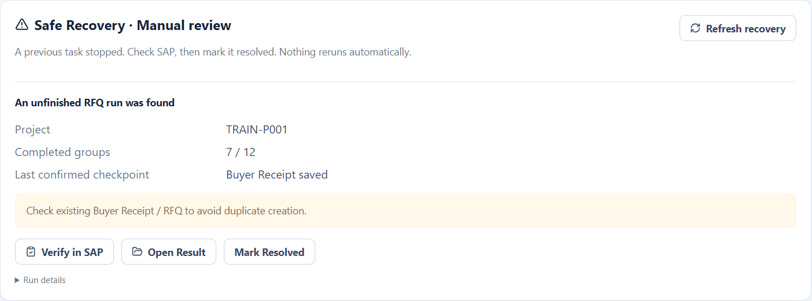

*Figure 14 - Safe Recovery with an illustrative 7/12 checkpoint; not automatic resume.*

1. Confirm the old task/engine has stopped. If it may still be running, resolution/result opening can be blocked.
2. Select **Verify in SAP**. This opens a **manual checklist**, not an automatic SAP verification or maintenance action.
3. Check the corresponding environment, Plant, Project, supplier and Materials in SAP **display mode**. Check existing Buyer Receipt and RFQ numbers. Do not click Create/Save during this review.
4. Use **Open Result** when available and compare saved Excel evidence. It may reflect only the last successful Excel save, not every SAP commit.
5. If uncertain, contact a Key User. Otherwise select **Mark Resolved**, read the confirmation and choose **Checked in SAP - Finish Review**.

There are no mandatory written notes/checkboxes in this review confirmation. Selecting the final button attests that the task stopped and you checked SAP; the time and review statement are recorded. It does **not** resume, replay, roll back SAP changes or turn the run into Success.

New RFQ runs are blocked until required reviews are resolved. A live old engine can also block other tasks. Unreadable recovery evidence cannot be dismissed as if no run existed. Do not delete hidden recovery files to bypass these protections.

<a id="section-14"></a>
## 14. Execution History

Open **Execution History** to review local runs. The list shows Operation, Started At, Duration, Status, Result and Details. Filter by operation/status and use the page controls; history uses **25 records per page**.

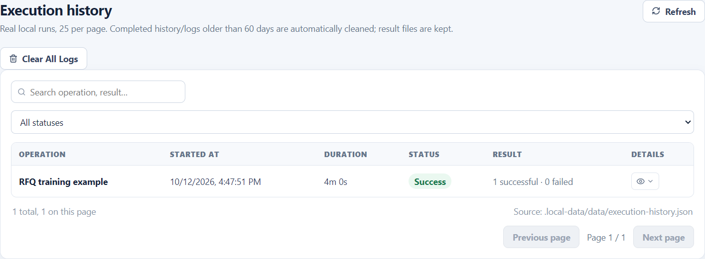

*Figure 15 - Execution History with an illustrative training record.*

Use the eye/Details button to see counters, SAP transaction, workers/sessions, result/backup/log paths and recovery review information. In this version, history displays saved file **paths**; it is not a universal one-click file opener. Use the task page's Open Result/Open Result File first, or copy a known saved path into File Explorer if instructed by your Key User.

### 14.1 Clear All Logs

**Clear All Logs → Confirm Clear All** removes eligible completed history and identified diagnostics for this user, across **all pages and filters**. It is not limited to the visible rows and cannot be undone. There is no individual row-delete button.

Original uploads, result workbooks, backups and SAP data are preserved by this manual cleanup. Running/unfinished or unresolved RFQ evidence is protected; cleanup is blocked during automation. Other unsafe/unreadable/locked evidence may be retained with a warning.

Cleared history no longer contributes to task ranking, ETA learning or estimated savings. Do not clear it before collecting support evidence.

<a id="section-15"></a>
## 15. Results, logs and local data

### 15.1 Where to find a result

Use the task's **Open Result** or RFQ's **Open Result File**. View Details shows saved paths. If the workbook cannot be opened, retain the message and ask your Key User; do not assume SAP was unchanged.

| Function | Original versus result | Can Excel stay open? |
| --- | --- | --- |
| RFQ | Original upload is preserved; a local working copy receives statuses/numbers. | Yes, but save before upload. Unsaved edits to the original are not the uploaded input. |
| SLT | Normally updates the input file. A locked original causes a separate timestamped result. | Yes. The open original may not contain the fallback result; use Open Result. |
| APQP | Writes date column E through Excel; creates a run backup before querying. | Yes, when the intended workbook can be safely attached. Read-only/conflicting copies require attention. |
| Source List | Writes result columns to the selected workbook; uses Excel when it detects that workbook already open. | Yes, when that workbook is writable and correctly detected. A failed save must be reviewed. |

### 15.2 Diagnostic access

For normal users, start with task **View Details** and Execution History. If a Key User requests logs, open **Settings → Advanced / Key User Settings → Diagnostics / 诊断日志**. This panel supports search, level filtering, Refresh, **20 records per page**, **Open Log Folder / 打开日志目录** and Clear All Logs.

There is no built-in Report Issue uploader or automatically exported support bundle. Open the log folder and share only the files requested through approved internal channels.

### 15.3 Retention and privacy

History, settings, browser profiles, diagnostics, backups and working results are local per-user data. The Hub does not add cloud telemetry or an automatic cloud log upload in V0.2.4. SAP and WebGUI traffic still goes to company systems, so this does not mean that no data ever leaves the PC.

Logs may contain full Info Record numbers, Material/supplier/Project/RFQ identifiers, SAP messages, quantities and local paths. Review/redact them before sharing outside the authorized support group. Hidden folders are not a security or encryption guarantee.

Automatic cleanup runs at startup and daily while the Hub is idle. Eligible completed history/logs and Hub-owned generated run files older than **60 days** can be removed. Unfinished/unresolved evidence is protected, and original inputs outside managed run storage are not cleaned.

> **IMPORTANT — Keep business records separately** — Manual Clear All preserves result workbooks/backups, but the separate 60-day generated-file retention can remove completed working results/backups under managed run folders. Save important results promptly to approved business storage; the Hub is not a permanent document archive.

<a id="section-16"></a>
## 16. Troubleshooting

The following **40 issue categories** map current messages/states to practical actions. Descriptions are plain-language summaries; exact wording can include a record or path. General Windows/SAP cases are explicitly identified. **Retry** means retry only after correction and any required SAP review; it never means blindly repeating Save/Create.

### 16.1 Installation, file preparation and access

| No. / message or situation | Meaning | User action | Retry? | Key User / IT? |
| --- | --- | --- | --- | --- |
| 01. No Hub window after Run (general Windows case) | Extraction, endpoint control or another instance may prevent a visible launch. | Use the complete local folder; check for an existing Hub window; retain warnings. Do not disable protection. | After cause is checked. | If still blocked. |
| 02. Unknown Publisher / security warning (general Windows case) | The build is unsigned. | Verify approved source and follow company policy. | Only if approved. | IT if blocked. |
| 03. ENGINE_UNAVAILABLE | An included automation component cannot be found/launched. | Re-extract the complete approved package; do not install Python as a workaround. | Before SAP starts. | Yes if persistent. |
| 04. Template downloaded, but not in Downloads | The chosen/default save location differs. | Read the returned full path and chosen filename; check Explorer there. | Download again if needed. | If no file exists. |
| 05. Template download failed | Destination permissions/path or template resource problem. | Choose a writable local destination; retain the message. | Yes, before execution. | If persistent. |
| 06. Missing required columns / invalid template | The input sheet/headers are not recognized. | Download a fresh current template; preserve headers and fill the input sheet. | Save and upload again. | If current template fails. |
| 07. Required fields are blank | A populated row lacks mandatory business input. | Correct the reported row; RFQ requires G/H/I/K, and Source List requires explicit Yes/No. | Save and upload again. | Business owner if unsure. |
| 08. Duplicate/ambiguous column or input sheet | More than one candidate header/sheet exists. | Keep one correct input sheet and unique required headers. | Before execution. | If unsure. |
| 09. Different business data / conflicting duplicate | Same record has incompatible supplier, mode or values. | Decide the correct approved input; remove unintended conflicting duplicates. | After correction. | Business owner if unclear. |
| 10. No pending / no matching records | All rows are skipped, blank, already dated or outside the selected Plant. | Check Plant, counts, existing dates/status and workbook contents. | Only with eligible data. | If counts are unexpected. |
| 11. Input changed after preview | The saved file no longer matches the reviewed input. | Save and re-upload; review the new preview. | Before execution. | Usually no. |
| 12. Another automation / OPERATION_IN_PROGRESS | One task or protected prior engine is already active. | Finish/stop the first task; check Safe Recovery. Do not open another Hub to bypass it. | When safe and idle. | If state is unclear. |
| 13. SAP sign-in / no eligible session | SAP is absent, not signed in, busy or on an unsuitable page. | Sign in to the intended environment; provide an idle window without unsaved work. | Use offered Continue/Recheck. | If unavailable. |
| 14. Multiple environments / wrong target | The Hub refuses to guess or use a mismatched environment. | Check the requested environment; leave one intended environment available, preserving unsaved work first. | After safe session correction. | Yes if unclear. |
| 15. Multiple-logon warning (external SAP case) | SAP has detected another login. | Do not choose to end other logins blindly; stop and confirm session policy. | After Key User guidance. | Yes. |
| 16. Certificate / browser sign-in not ready | An SLT worker has not reached signed-in ME12. | Select your authorized certificate and complete login in every window, then recheck. | Offered recheck. | If certificate/access fails. |
| 17. BROWSER_LAUNCH_FAILED | Selected Chrome/Edge is unavailable or cannot start. | Ask Key User to check the installed/selected browser and endpoint policy. | Before updates start. | Yes if persistent. |
| 18. Navigation failure / URL/network error | WebGUI could not be reached. | Check company network/VPN; Key User checks URL/browser. | Before writes, after correction. | If persistent. |

### 16.2 SAP processing and safe pauses

| No. / message or situation | Meaning | User action | Retry? | Key User / IT? |
| --- | --- | --- | --- | --- |
| 19. Commodity Information Required | Verified NPL Commodity is missing. | Correct it in a separate session; use I've Fixed It - Recheck. | Offered recheck only. | If no maintenance permission. |
| 20. NPL Data Could Not Be Read | A technical read failed; missing Commodity is not proved. | Recheck the expected NPL data/screen; do not invent a Commodity value. | Offered recheck only. | If persistent. |
| 21. Open Fix Session unavailable | No extra correction session can be opened. | Use an approved separate existing session or ask Key User. Keep the paused NPL page unchanged. | Recheck after correction. | If no safe session exists. |
| 22. NPL scope/reset/matching issue | Correct materials cannot be uniquely proved, or the old selection cannot be safely cleared. | Stop, inspect affected Material/Project and details. | After SAP/result review. | Yes. |
| 23. Existing RFQ / ALREADY_EXISTS | The Hub detects prior processing. | Review the existing document and skipped status; do not force a duplicate. | Not to create again. | If existing document is wrong. |
| 24. PPAP date input required | Date is missing/invalid/too early for the required Buyer Receipt state. | Review row status and approved date; correct only as instructed. | After document/result check. | If unsure. |
| 25. Buyer Receipt not green / save not confirmed | The required saved Buyer Receipt state was not proved. | Follow a specifically offered correction checkpoint; otherwise Stop and review. | Only verified continuation. | Yes if uncertain. |
| 26. RFQ staging/supplier/checkbox mismatch | Correct RFQ list, unique rows or editability is not proved. | Correct only at the offered staging checkpoint; otherwise Stop. | Offered verification only. | Yes if uncertain. |
| 27. SAP is responding slowly | The Hub is waiting for a response, not proving failure. | Wait; avoid manual clicks and forced closes. Use Stop safely if needed. | Do not restart while active. | If repeatedly prolonged. |
| 28. SAP_SLOW_HARD_TIMEOUT / expected state not reached | Safe wait limit was exceeded. | Read the pause; an available Check Again verifies state only. Stop if no continuation is offered. | Never replay Create/Save. | If not resolved. |
| 29. Unknown/stale popup or uncertain SAP state | Safe continuation cannot be established. | View Details, Stop and verify SAP objects/results. | After Key User review. | Yes. |
| 30. RFQ created but number not confirmed | A document may exist despite no captured number. | Check SAP before any rerun; use Safe Recovery if shown. | Not blindly. | Yes. |
| 31. SLT record cannot be verified / ME12_RECORD_FAILED | Update/save or expected identity/value failed. | Review the Info Record and partial result; obey Stop-only pause. | After SAP verification. | If uncertain or unauthorized. |
| 32. Source List duplicate/overlapping target validity | No unique target row can be chosen safely. | Check supplier, organization and dates with Key User. No duplicate is automatically added. | After approved correction. | Yes. |
| 33. Source List controls/readback/read-only error | A complete safe row state could not be read or edited. | Stop and review details/SAP; do not force Save or delete old suppliers. | After state review. | Yes. |
| 34. NO_RESULT / NO_DATE (APQP) | No usable query result, or the selected detail's date is blank. | Read the row message; do not replace it with a guessed date. | If corrected source data warrants it. | If business result is unexpected. |
| 35. GuiXT process not running / please logon again (external SAP case) | SAP frontend configuration/session needs attention. | Stop safely; save work and ask IT/Key User before logging on again. | After frontend and result review. | Yes. |

### 16.3 Excel results, recovery and support

| No. / message or situation | Meaning | User action | Retry? | Key User / IT? |
| --- | --- | --- | --- | --- |
| 36. Excel locked / result switched / workbook read-only | Original cannot be safely written or attached. | Use the returned result path. For read-only/conflicting copies, save work and follow the module instructions. | File action after correction; review SAP first. | If persistent. |
| 37. EXCEL_CONFLICT / WRITE_ERROR / result save failed | Input/date changed or result writeback failed. SAP may already have been processed. | Stop edits, retain backup/log and review SAP and file; do not rerun to repair Excel automatically. | After verification. | Yes. |
| 38. Result unavailable / unsafe path / recovery result unavailable | No approved saved file can be opened, or old engine is not confirmed stopped. | Check the returned path and recovery state; never infer no SAP changes. | Open after safe correction. | Yes if missing/blocked. |
| 39. Unfinished RFQ / unreadable recovery evidence | Prior run needs manual review, or evidence cannot be trusted. | Verify in SAP, compare results and Mark Resolved only after checking; preserve corrupt evidence. | No automatic resume. | Yes if unclear/unreadable. |
| 40. Diagnostics/settings/history cleanup unavailable | Local files, permissions or active work prevent the request. | Finish active tasks; preserve evidence and check permissions with support. Do not delete hidden data manually. | Safe UI action after correction. | If persistent. |

<a id="section-17"></a>
## 17. Safe operation rules

- Do not run from inside the ZIP or a restricted/shared/network execution folder.
- Do not remove package files or mix versions.
- Do not upload unsaved inputs or edit/sort them during processing.
- Do not use a SAP session/browser window that the Hub is actively controlling.
- Do not close SAP or force-terminate the Hub during a pending Save/Create merely because progress is slow.
- Do not click Continue until you have corrected the specific requested issue.
- Do not start the same batch twice or use another Hub to bypass an active/unfinished task.
- Do not delete supplier rows to imitate a Source List source switch; use the approved Yes/No rule.
- Do not change Advanced settings or manually delete recovery records without Key User instruction.
- Do not treat Clear this page or Stop as SAP rollback.
- Do not share logs externally before reviewing their business identifiers and paths.
- Never send your SAP password or certificate private key to support.

<a id="section-18"></a>
## 18. Frequently asked questions

**Do I need Python or Node.js?** No, not for the packaged application. Keep the complete extracted package.

**Can I run it from a shared drive?** Use a writable local C: folder. Company/network-managed locations can block or slow startup.

**Can Excel stay open?** Yes, with the module-specific rules in section 15. SLT can return a separate result when the original is locked. Save before uploading; do not edit inputs during processing.

**Can I keep working in SAP?** Do not use the automation's active sessions. A separate session may be used only when it is not assigned to the Hub and your company permits it. APQP can use several idle sessions, so check actual worker use first.

**Why did the maximum worker setting open fewer windows?** It is an upper limit. SLT also considers task count and browser availability; APQP uses existing eligible idle sessions. RFQ/Source List remain sequential.

**Why is Start unavailable after I upload?** Wait for validation, then check eligible/invalid counts and current business choices. Another active task or pending RFQ review may block starting. File changes require a fresh preview.

**Why is Continue missing?** An uncertain write or unsupported screen deliberately allows Stop only. It is not a permission to ignore the error.

**Why did No clear the Cost Breakdown check?** That is the RFQ rule. Yes leaves the current SAP state unchanged; No/blank clears it.

**Why were Source List's old Fix/MRP fields cleared?** The row was set to Dual Sourcing No. The old supplier row/date is retained; Yes preserves the other indicators.

**Where is the RFQ number?** On the RFQ result page and in RFQ Number in the working result workbook. Missing confirmation requires SAP review before retrying.

**Does Mark Resolved restart my RFQ?** No. It records manual review only; nothing reruns or becomes Success automatically.

**Does the Hub guarantee a 20-second run or the video's speed?** No. SAP latency, group size, login and save confirmations affect duration. ETA and time saved are estimates; accelerated demonstration playback is not an execution-time guarantee.

**Where are the logs and can I delete them?** Use Settings → Advanced / Key User Settings → Diagnostics. Clear All Logs removes eligible completed history/logs across all filters; active/unresolved evidence is protected. See sections 14-15.

<a id="section-19"></a>
## 19. Get support and report a problem

Contact your designated **Purchasing Key User** first. Use local IT for installation blocks, network/VPN, certificate, browser, SAP GUI/Scripting or GuiXT issues. The application does not provide a built-in Report Issue submission tool or a published support email in this release.

Before contacting support, collect:

1. Application version **0.2.4** and function name.
2. Date/time of the problem and intended SAP environment/Plant.
3. Run ID, group and Excel row(s), if shown.
4. Screenshot of the actual user-facing message, not just the empty task page.
5. Execution History status and successful/skipped/failed counts.
6. Relevant View Details text and known result/backup locations.
7. Whether Excel was open, how many workers/sessions were active, and whether Stop was requested.
8. Whether SAP may already have created/updated anything, including confirmed document numbers.
9. Only the diagnostic files requested by the Key User, sent via approved internal channels.

Suggested report:

```text
Application version: 0.2.4
Function:
Problem date/time:
SAP environment / Plant:
Run ID / Group / Excel row(s):
Message and History status:
Confirmed successful/skipped/failed counts:
Possible SAP changes and document numbers:
Excel open? Workers/sessions? Stop requested?
Saved result location:
Attachments: approved screenshot/details/log files
```

Never send your SAP password, certificate private key or an unreviewed confidential workbook. Keep support evidence before using Clear All Logs.

<a id="section-20"></a>
## 20. Key User appendices and error reference

### 20.1 Appendix A - Advanced information

Normal users do not need this section for daily operation. Advanced settings include selected Chrome/Edge, WebGUI URL template, Info Record worker windows (UI range 1-8), APQP maximum sessions (1-5; default 3), default template download location and manual-time baselines/calibration. RFQ and Source List do not become parallel because these values change.

Native tasks require the intended signed-in environment and eligible idle sessions; do not work around a mismatch by opening repeated logins. The normal RFQ UI targets VCE Production [949] / Client 100; a QA workflow is not exposed there.

The standard per-user root is `%APPDATA%\sap-automation-toolbox\.local-data\`. Use the displayed Diagnostics paths as the authority because managed/test environments can differ.

| Location under .local-data | Purpose |
| --- | --- |
| data/settings.json | Local preferences and company settings. |
| data/execution-history.json | Local history, ranking and timing evidence. |
| data/rfq-recovery/ | Persistent RFQ manual-review evidence, protected while unresolved. |
| data/interactions/ | Pause/request diagnostic state; not permission to replay SAP actions. |
| logs/automation-runs/ | Guided-task backups, generated files and diagnostics. |
| logs/rfq-runs/ | RFQ working results and run diagnostics. |
| logs/me12-error-screenshots/ | SLT error screenshots when generated. |
| browser-profiles/ | Isolated automation browser profiles/login state. |

Support files can include structured application logs, RFQ engine/run/interaction diagnostics, APQP row CSV and Source List `me01-errors.log`/`me01-performance.jsonl`. Their content can contain business identifiers. No hidden-file deletion should be used as an automatic recovery procedure.

Current history is bounded and retained locally; eligible completed records older than 60 days are cleaned, and ordinary history has a 500-record cap with running/unresolved work protected. ETA uses local past processing speed and excludes reported user-action/recheck intervals; a cleared history reduces learning. Neither ranking nor ETA can authorize a SAP write.

### 20.2 Appendix B - Current error and recovery reference

These are actual identifiers or recorded outcome states in the released code. They appear in details/logs, not necessarily as the dialog title. Related identifiers share a support action. This is not a list of errors that every ordinary run will show.

| Identifier(s) | Plain-language meaning | Support route |
| --- | --- | --- |
| INVALID_CONFIG; RFQ_PREVIEW_FAILED; ME12_PREVIEW_FAILED; ME01_PREVIEW_FAILED | File/business configuration failed validation. | Correct saved input and review a new preview. |
| RFQ_TEMPLATE_DOWNLOAD_FAILED; ME12_TEMPLATE_DOWNLOAD_FAILED; ME01_TEMPLATE_DOWNLOAD_FAILED; APQP_TEMPLATE_DOWNLOAD_FAILED | A current template could not be saved. | Check destination and intact package. |
| NO_MATCHING_RECORDS | No valid SLT records for the selected Plant. | Review Plant and input data. |
| OPERATION_IN_PROGRESS | Another task/protected operation is active. | Finish safely or resolve required recovery. |
| ENGINE_UNAVAILABLE; EXECUTION_FAILED; BATCH_FAILED; UNKNOWN_ERROR | Engine/batch did not return safe completion. | Preserve details and assess whether SAP work started. |
| BROWSER_LAUNCH_FAILED; INVALID_SAP_URL; NAVIGATION_TIMEOUT; NAVIGATION_FAILED | WebGUI browser/URL/network failed. | Key User/IT checks selected browser and access. |
| IPC_FORBIDDEN | An application request was not permitted. | Use approved package; retain details for support. |
| CANCELLED; SAP_WAIT_BEFORE_WRITE | Task cancelled or read-only wait stopped before a new action. | Review saved partial results; not rollback. |
| SIGN_IN | A login/eligible-window check requires user action. | Complete requested sign-in, then offered verification. |
| COMMODITY_MISSING; NPL_READ_FAILED | Commodity is missing, or NPL cannot be read; these are different. | Correction-session/recheck route, or technical investigation. |
| NPL_MATERIAL_RESET; NPL_MATERIAL_SCOPE; NPL_MULTI_MATERIAL; NPL_MATCH; NPL_REMATCH; NPL_REUSE | NPL selection, scope, mapping or reuse cannot be proved safe. | Check Material/Project and current screen; no blind restart. |
| SAP_CONTROL; SAP_SELECTION; SAP_TIMEOUT; SAP_POPUP; SAP_SLOW_HARD_TIMEOUT | Expected control, selection, response or screen could not be confirmed. | Follow allowed pause; unknown write outcomes require SAP review. |
| CREATE_BUYER_RECEIPT; BUYER_RECEIPT_MATCH; BUYER_RECEIPT_SAVE; BUYER_RECEIPT_SAVE_CONFIRM; BUYER_RECEIPT_SAVE_POPUP | Buyer Receipt creation/matching/save state failed. | Verify the existing Buyer Receipt and supported recovery point. |
| BUYER_RECEIPT_SAVED_GREEN; PROD_RFQ_STAGING | Recognized manual recovery checkpoint, not automatic success. | Recheck the corrected saved-green BR or current staging list. |
| PPAP_DATE_WRITE; PPAP_DATE_CONTINUE; INPUT_REQUIRED_PPAP_DATE | PPAP date update/continuation needs attention. | Review approved date and actual SAP/document state. |
| BUYER_RECEIPT_ERROR_RECOVERY; BUYER_RECEIPT_PREREQUISITE_CONTINUE; EXISTING_RFQ_CONTINUE | A prerequisite/existing-document recovery step could not complete. | Retain known documents and inspect the current screen. |
| PREFERRED_SUPPLIER_WARNING | Preferred-supplier issue needs review. | Check business master data; do not ignore a warning blindly. |
| PROD_CREATE_RFQ_FROM_BR; PROD_CREATE_RFQ_FROM_BR_POPUP; PROD_RFQ_STAGING_TIMEOUT | Transition from saved Buyer Receipt to RFQ staging could not be verified. | Supported staging check only; do not repeat the creation button. |
| PROD_COST_BREAKDOWN; PROD_RFQ_BUTTON; PROD_RFQ_BUTTON_GUARD | Checkbox update or correct RFQ action is not proved safe. | Check intended supplier, editability and screen with Key User. |
| RFQ_GRID_MATCH; RFQ_INTERMEDIATE_MATCH | Material rows cannot be matched uniquely. | Do not delete/merge SAP rows automatically; review. |
| RFQ_DUE_DATE; RFQ_EMAIL; RFQ_ATTACHMENT_UNSUPPORTED; RFQ_COMMENT_UNSUPPORTED | Header/date/email or unsupported optional request failed. | Correct approved inputs; no attachment/comment feature is promised by the normal template. |
| RFQ_POPUP; RFQ_POPUP_LOOP; RFQ_POPUP_UNKNOWN; RFQ_POPUP_WAIT; STALE_POPUP | RFQ confirmation/popup state is not safely understood. | Preserve current state and stop/review; no blind clicking. |
| RFQ_NUMBER; CREATED_NUMBER_NOT_FOUND; POST_RFQ_RECOVERY | RFQ may exist; its number or return state is uncertain. | Verify SAP before any retry. |
| ALREADY_EXISTS; DUPLICATE_SKIPPED | Existing/identical duplicate row is skipped. | Review status; do not force a duplicate creation. |
| ME12_RECORD_FAILED; UNVERIFIED_STATE | A purchasing record/query cannot safely complete. | Stop, retain partial results and verify the actual record. |
| NO_RESULT; NO_DATE; DETAIL_POPUP | APQP has no usable result/date or a detail popup. | Read row log; a detail popup is not an invented date. |
| EXCEL_CONFLICT; WRITE_ERROR | APQP row/date changed or Excel writeback failed. | Preserve file/results; resolve the workbook conflict with support. |

Source List's row/control/overlap/read-only failures also include explanatory messages and stage text rather than a unique code for each row error. Do not replace the actual details with an invented error ID.

### 20.3 Appendix C - Common bilingual controls

| English | 中文 |
| --- | --- |
| Operations / Open / Info | 操作中心 / 打开 / 说明 |
| Download template / Upload completed template | 下载模板 / 上传已填写模板 |
| Start Automation / Start query | 开始自动化 / 开始查询 |
| Confirm and Start / Ready to update | 确认并开始 / 准备更新 |
| Stop safely / Stop Automation | 安全停止 / 停止自动化 |
| Clear this page / Confirm Clear | 清空本页 / 确认清空 |
| View Details / Open Result File | 查看详情 / 打开结果文件 |
| I've Fixed It - Recheck / Open Fix Session | 已修复，重新检查 / 打开修正会话 |
| Verify in SAP / Mark Resolved | 在 SAP 核查 / 标记已处理 |
| Checked in SAP - Finish Review | 已核查，完成处理 |
| Clear All Logs / Confirm Clear All | 一键清空日志 / 确认清空全部 |

When the application version changes, the Key User should review this manual, templates, screenshots, business rules and error reference before issuing an updated manual.

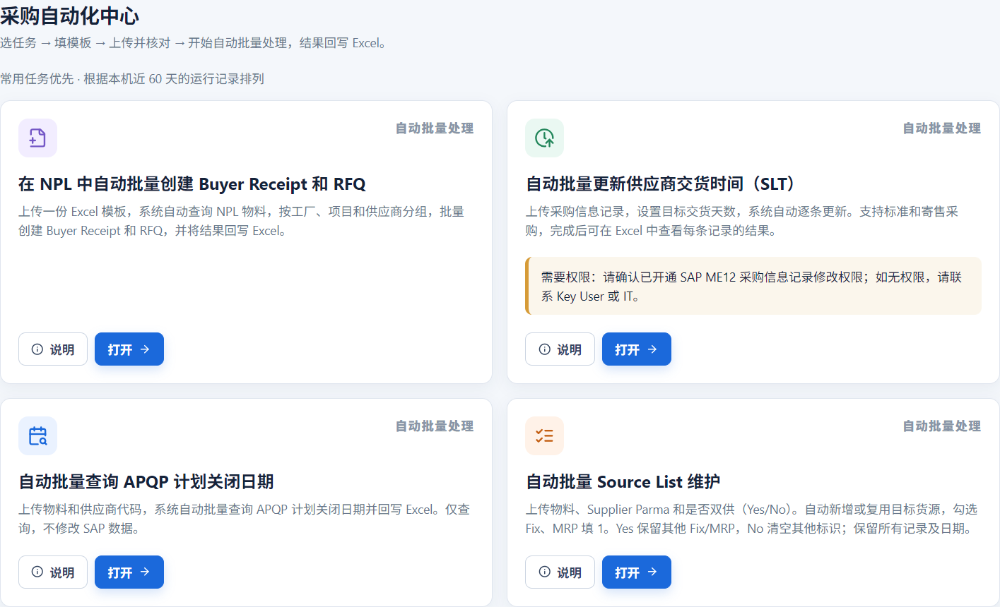

*Figure 16 - Chinese Operations labels for the same four released tasks.*
